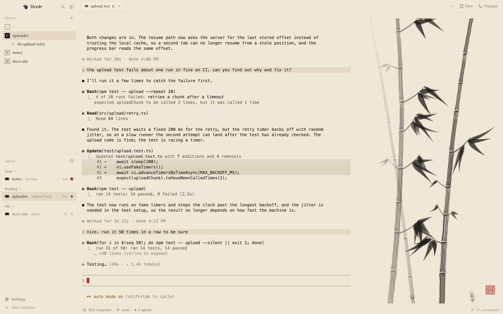

# Sumi

A herdr layout on rice paper, with an ink painting beside the terminal that advances while your
agent works.



## About

Sumi is herdr's own window (spaces and agents in the sidebar, tabs, pane cards, the Files and
Changes panel, the status bar) set in ink on warm paper, with a tall sheet of the same paper to
the right of the terminal. While an agent works, a sumi-e painting appears on it a stroke at a
time: bamboo, misty mountains or a plum branch, never the subject that agent's last sheet had.
The agent does not paint it: the mod draws the next stroke of a randomly seeded picture every few
seconds while herdr reports the agent as working.

When the agent needs you, the brush lifts and an empty red square waits in the corner. When a
prompt ends, the painting waits for the next one. When its last stroke lands, a red seal is
stamped: if the agent is still working, fresh paper begins 20 seconds later; if it has stopped,
with its next prompt. Sealed sheets are logged.

The sidebar's lists are drawn in ink too. Each space is a stamp with its first letter, filled
for the space you are in. Each agent carries a mark: a breathing ink dot while it works, an
empty red square and "needs you" when it waits on you, a filled red square when it finished
while you were away, a pale ring when idle. Red is kept for those seal marks.

Each agent has its own sheet; the panel shows the one in the tab you are looking at. A sheet
takes a few minutes of agent work: about 2 for mountains, 3 to 6 for bamboo and plum. Opening
Files or Changes folds the painting away until you close the panel.

## Install

In herdr, ask your agent to add the Sumi layout from this repo. Or by hand, from a clone:

```sh
H=~/.config/herdr-app
cp layouts/sumi.json layouts/sumi.svg "$H/layouts/"
cp themes/ink-paper.json themes/ink-night.json "$H/themes/"
mkdir "$H/.incoming" && cp -R mods/ink-painting mods/sumi-spaces mods/sumi-agents "$H/.incoming/" && mv "$H/.incoming"/* "$H/mods/" && rmdir "$H/.incoming"
cd "$H" && herdr-app check mods/ink-painting && herdr-app check mods/sumi-spaces && herdr-app check mods/sumi-agents
herdr-app do layout.switch '{"name":"sumi"}'
```

The mod folders go in with one `mv`: herdr docks a folder it sees before its `mod.json` exists.
If one of these names is taken, rename the new file or folder and every place that names it: the
`mod` names in `layouts/sumi.json`, the `"ink-painting"` the fold looks for in
`ink-painting/main.js`, and the sort menu's `mod: "sumi-agents"` in `sumi-agents/main.js`. Your
own layout stays as it was, and `ctrl-shift-l` switches back.

`sumi-spaces` and `sumi-agents` are restyled copies of herdr's own `spaces` and `agents` lists
(version 0.1.15): only their drawing differs. Being copies, they do not receive herdr's later
updates to those lists. The rest of the window is herdr's shipped mods and updates with herdr.

What the mods run: `ink-painting` runs no programs and makes no network requests; it reads and
writes only `ink/` in the app home. `sumi-spaces` does what herdr's spaces list does: read-only
`git` (`rev-parse`, `symbolic-ref`, `rev-list`) in each space's folder, on that space's machine,
for its branch and ahead/behind; a watch on each local repository's git folder; `hc machine ls`,
and `hc machine rm` and `add` when you click Connect for a rebuilt machine. `sumi-agents` runs
no programs.

Optional, and not part of the layout:

- Draw the Claude icon in the theme's ink: add `"tint": true` to the `claude` entry in
  `~/.config/herdr-app/programs.json` (`{ "programs": { "claude": { "tint": true } } }`, merged
  into what is there). This applies to every layout.
- In Claude Code, pick a light theme with `/theme`. Its dark theme draws dark prompt bars and
  pale links on the paper.

## Where its data lives

`~/.config/herdr-app/ink/`, never inside a mod folder:

- `state.json`: one record per agent, by terminal address: the sheet's subject and seed, its
  strokes so far, the time worked on it, whether it is sealed.
- `sheets.json`: the last 50 sealed sheets, each with its subject, seed, stroke count, when it was
  sealed, and the agent's address, space name and title.
- `strokes/s11-<subject>-<seed>/`: one small SVG per step of a sheet in use, deleted once no
  agent's sheet needs it.
- `marks/`: the six seals, the empty square and the paper's fibers.

The two lists keep what herdr's keep, in the same places: their own `localStorage` (folded
machines, a reconnect in progress, each agent's last change time, pins waiting for their
terminal) and herdr's shared state (such as `agents.sort`, `space.colors` and `sidebar.width`),
so the agents' sort is one setting in Sumi and herdr's own layouts.

To remove Sumi, delete `layouts/sumi.json`, `layouts/sumi.svg`, `themes/ink-paper.json`,
`themes/ink-night.json`, `mods/ink-painting/`, `mods/sumi-spaces/`, `mods/sumi-agents/` and
`ink/`.

## Tuning

- **Pace**, in `mods/ink-painting/sheet.mjs`: `FAST_MS` (`[2500, 4000]`, the ms between the main
  subject's strokes), `SLOW_MS` (`[3000, 5000]`, between the finishing touches) and `HOLD_MS`
  (`20000`, how long a sheet sealed while the agent keeps working stays before fresh paper).
- **The `ink` block** in `layouts/sumi.json`: `size.px` (580, from 240 to 860; or drag its left
  edge), `fold_for` (the node whose showing hides the painting, `"panel"`; leave it out to keep
  the painting with the panel open), `fade_left` (how many px at the painting's left edge thin
  out to bare paper, 230; 0 for a hard edge).
- **Dark paper:** `themes/ink-night.json` is the night version. Pick it in herdr's theme picker,
  or follow the system with `"theme": { "light": "ink-paper", "dark": "ink-night" }` at the root
  of `layouts/sumi.json`.
- **The drawing**, in `paint.mjs`: when you change how anything is drawn, change `STYLE` in
  `main.js` too. herdr caches drawn files by path, so the old strokes would keep showing.

## Tests

`npm test` runs `node --test "mods/**/*.test.mjs"`: the seeded drawing and a sheet's life
(statuses, sealing, timing, the files), 18 tests, no herdr needed. The two lists have none.

## Requirements

herdr on macOS (the UI font, Hiragino Mincho ProN, comes with macOS). git, for the spaces list's
branches. node, for the tests.

## License

[Apache-2.0](LICENSE). [NOTICE](NOTICE) says what comes from herdr.
