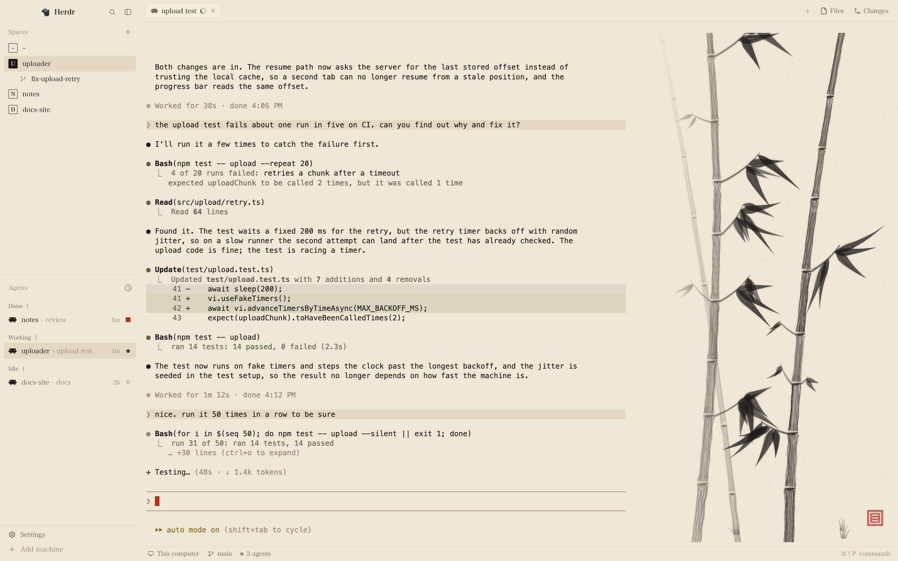

# Sumi

herdr's own window on rice paper, with an ink painting beside the terminal. The sidebar, tabs,
pane cards, Files and Changes panel and status bar are herdr's, in ink-black Hiragino Mincho on
one warm paper color; the spaces and agents lists are herdr's own, redrawn in ink: letter stamps
for spaces, ink and seal-red marks for agents. To the right of the terminal a 580 px panel of the
same paper holds a tall sheet that the agent in view paints while it works, one stroke at a
time: bamboo, misty mountains or a plum branch. When the agent needs you the brush lifts and an
empty red square waits in a lower corner; a prompt ending only rests the brush, so one painting
runs across prompts; when the last stroke lands a red seal is stamped, and fresh paper follows
20 s later if the agent is still working, else with its next prompt.

## What you see

Left to right: the sidebar (268 px), the terminals (the rest), the painting (580 px) and, when
opened, the Files and Changes panel (368 px), which takes the painting's place. Over the
terminals and the painting, the tab bar (42 px); under them, the status bar (28 px). No system
title bar: the macOS window buttons sit at `[12, 16]`. The mods' text is Hiragino Mincho ProN
(`ui_font`); the terminals use the person's own font (the layout sets none), padded `[14, 12]`.
Colors below are theme names; the values are in **The themes** at the end of this section. The
layout draws no column dividers: in `ink-paper` the sidebar, the terminals and the painting are
all `#efe7d6`. In the two lists, red (`accent`) is kept for seal marks: the blocked and done
squares and the words `needs you`.

- **Sidebar**, 268 px (44 to 480), on `chrome`, not resizable by drag: herdr's
  `workspace-chrome` (46 px, drags the window), then the spaces and agents lists sharing the
  rest equally (each at least 90 px), then the `workspace-chrome` footer (69 px). Narrower than
  160 px the lists draw a compact rail. Corners in both lists are 2 px.
  - **Spaces** (`sumi-spaces`), 13 px text. A 31 px head: `Spaces` (11.5 px, `dim`, 16 px in)
    and a 26 px `+`. Rows are 30 px (a worktree under its checkout, 28 px), 8 px padding,
    `selected` behind the space you are in, `hover` under the pointer. Each row starts with the
    space's stamp: an 18 px square, 1.5 px border, the first letter of its name in 10.5 px bold;
    outlined in `muted` with a `foreground` letter, or, for the space you are in, filled
    `foreground` with the letter in `chrome`. A worktree row is indented 22 px and has herdr's
    branch icon (13 px, `dim`) instead of a stamp. Then the name (`foreground`, at most 150 px)
    and, at the right in 11.5 px `dim`, only what is unusual: the repository, the branch (not
    `main` or `master`, not when the name already says it), and ahead/behind as `↑2 ↓1` in
    `muted`. While a row is dragged, a 2 px `foreground` line shows where it will land.
    - With more than one machine, a 26 px header per machine, 11 px `dim`: herdr's monitor or
      server icon (13 px), the name (`This computer` for this one), its state when not
      connected, a `+` when connected, a 6 px square in `foreground` when connected (else
      `dim`), and the fold chevron. A machine that needs a login shows `needs a login: run` in
      `foreground`, the command in `muted` and a `Copy` button on `raised`. A rebuilt one shows
      `rebuilt ·` and `Connect` (`muted`; an error, in its place, in `foreground`). A machine
      with no spaces shows `New space there` in `dim`.
    - In the rail: 32 px cells, 26 px tall, each the space's number (`foreground` for the space
      you are in, else `muted`) with `●` in `muted` at its right when an agent in it is blocked
      or done, else `·` in `dim`. A machine's icon carries the 6 px connection square at its
      corner.
  - **Agents** (`sumi-agents`), 13 px text, a 1 px `border` line at its top. A 41 px head:
    `Agents` (11.5 px medium, `dim`) and the sort icon (herdr's clock for `Priority`, layers for
    `Grouped by space`, 14 px, `dim`). Group headings, 30 px (8 px of it above the text), 11 px
    medium in `muted`: one per space (grouped) or `Needs you`, `Done`, `Working`, `Idle`
    (priority), with `Pinned` first; the count in `dim` (always in priority, else when folded);
    folded, a chevron and, in the grouped view, the group's most urgent mark unless that is
    idle. Rows are 30 px, `selected`
    behind the focused agent: the program's icon (16 px), the name (`foreground`; `muted` when
    idle and not focused; in priority and pinned rows, the space's name and `· detail` in
    `dim`), another machine's name (10 px, `dim`), a fold chevron with the sub-agent count when
    it has sub-agents (`muted` when folded), then the time since its state changed (11 px
    `dim`: `<1m`, `12m`, `3h`, `2d`) or, under the pointer, the pin button, and last the
    status mark. Sub-agent rows are 26 px, 12.5 px text, under 1.5 px tree lines in `input`.
    - The marks, each 13 px wide with its margins: **working**, a 7 px `foreground` dot that
      breathes (opacity 0.35 to 1 over 1600 ms); **blocked**, `needs you` (10.5 px semibold,
      `accent`) and an empty 9 px square with a 1.5 px `accent` border and 1 px corners;
      **done**, the same 9 px square filled `accent`; **idle**, a 7 px ring, 1.5 px `dim`; any
      other status, nothing. Where a heading already says `Needs you` (priority rows), on a
      folded heading and in the rail, blocked is the square alone.
    - The sort menu, a 200×140 popup on `popover`, 12.8 px: `Sort agents` (11 px, `dim`), then
      `Priority` and `Grouped by space`, 31 px rows with their icon in `muted` and a check in
      `foreground` by the one in use.
    - In the rail: 26 px rows, the agent's number in `muted` and its mark (blocked as the
      square alone), and `»` at the bottom to widen the sidebar.
- **Tab bar**, 42 px, drags the window: herdr's `tabs` (tab pills, the `+` menu, the Files and
  Changes buttons).
- **Terminals** (`main`): the shown tab's panes, 8 px below the tab bar and 8 px above the status
  bar, no side padding. In a split tab each pane is a card on `background`: 2 px radius, a 1 px
  `border` line that turns `muted` (not `accent`) while the pane has the keyboard, 8 px between
  cards, herdr's `pane` header (30 px, at the top, always shown). A tab's only pane has no frame
  (`lone` is unset).
- **The painting** (`ink`), 580 px (240 to 860; the boundary with the terminals drags), on
  `surface`, flush against the terminals. It holds one sheet, 720×1400 units, scaled to the
  largest size that fits the block, centered across and standing on the block's bottom. The sheet
  has no edge of its own, only faint fibers: 260 short lines (6 to 28 units) in `foreground` at
  10% opacity. Strokes are `foreground`; plum blossoms, buds and fallen petals are `accent`. Over
  the block's left 230 px (`fade_left`) the painting thins out to bare paper, so it meets the
  terminal without a line. Under 160 px wide or 140 px tall, the block is bare `surface`.
  - **Bamboo:** two or three stalks rising from below the sheet's foot, each up to 13 segments
    125 to 195 units long, a dark stroke cupped across each joint, each segment 6% thinner than
    the last and its lean drifting; with three stalks the first is pale (26% ink, thinner).
    Twigs from 6 to 8 of the joints, each with a fan of 3 to 6 leaves (pressed in at the base,
    widest a quarter along, a long taper to the point). Finishing touches, 20: more leaves on
    the twigs, small sprigs of two leaves from the joints, tufts of grass along the foot.
  - **Misty mountains:** on 65% of sheets a moon first, a dry ring of radius 36 to 52 units with
    a faint glow, high on the sheet; a pale distant range; three ridges (based at 40%, 55% and
    70% down the sheet), each a wash that fades down into mist, darker toward the front, the two
    nearer with a dry ridge line in broken runs; texture strokes down the slopes, more on the
    nearer ridges; two clusters of moss dabs on the near ridge; 2 to 4 groves of 2 to 4 trees
    on the near ridge, each tree a short trunk and one upright dab of foliage. Finishing touches,
    16 or 17: flocks of 2 or 3 distant birds, reeds, mist, more groves, moss, texture strokes,
    and on half of sheets a small boat with its one figure and two lines of water.
  - **Plum branch:** a gnarled branch coming in from the left or right edge 70 to 92% of the way
    down, its leader turning upward until it nears the top, the side branches forking up to four
    levels deep; moss dots and knots on the older wood. A tip is left bare 22% of the time; of
    the rest, 72% get a blossom (five `accent` petals around four ink stamen dots) and the others
    a bud (an `accent` dot with one ink dot). Finishing touches, 21: buds, blossoms, petals
    fallen below the branch, moss, thin new shoots straight up.
  - **The seal:** an `accent` square, about 44 units across, in the lower corner with less ink in
    it (a plum sheet: the corner away from its branch), about 40 units in from the side and 44 up
    from the bottom. Solid at 92%, with a line carved just inside its edge and a mark of three
    carved bars in the middle (one of six, by the sheet's seed), its edges and fill grained like
    an uneven stamp. The seal and the square are drawn over the fade, so they never thin out.
  - **The empty square** (the agent needs you): the same square's outline in four short
    `accent` strokes at 90%, one per side, slightly uneven, in the same spot.
  - No agent, or an agent that has not worked since Sumi first saw it: bare paper.
- **Files and Changes**, 368 px (280 to 900), hidden until opened from the tab bar: herdr's
  `files` and `changes` in a stack, Files first.
- **Status bar**, 28 px: herdr's `workspace-status`.

**The themes.** `themes/ink-paper.json`, the layout's own: `background`, `canvas`, `surface` and
`chrome` `#efe7d6`, `popover` and `raised` `#f4eddd`, `hover` `#e8dfcb`, `selected` `#e3d9c3`,
`border` `#ddd3bd`, `input` `#c9bda3`, `foreground` `#1c1917`, `muted` `#6b6457`, `dim`
`#948a78`, `accent` `#b3301f`, `accent_foreground` `#f4eddd`, `solid` `#1c1917`,
`solid_foreground` `#efe7d6`, `selection` `#d9cfb8`; statuses `working` `#1c1917`, `blocked` and
`done` `#b3301f`, `idle` `#948a78`, `unknown` `#b8ae99`. Terminals: background `#efe7d6`,
foreground `#1c1917`, cursor `#b3301f`, selection `#d9cfb8`, ANSI `#1c1917 #a8321f #55683a
#8a6a1c #3d5670 #6f4d68 #3f6b64 #b8ae99 #6b6457 #c0402b #6a7f49 #a17c22 #4f6c8c #86607e #4f8279
#948a78`.

`themes/ink-night.json`, the same paper at night (the layout doesn't name it; it is picked in
herdr's theme picker): `background` and `canvas` `#151413`, `surface` `#1a1917`, `chrome`
`#121110`, `popover` and `raised` `#1f1d1b`, `hover` `#262321`, `selected` `#2e2a27`, `border`
`#2a2724`, `input` `#36322e`, `foreground` `#ddd7cb`, `muted` `#9a9388`, `dim` `#6e685f`,
`accent` `#c8402f`, `accent_foreground` `#f3ede2`, `solid` `#ddd7cb`, `solid_foreground`
`#151413`, `selection` `#3a3631`; statuses `working` `#b9b2a5`, `blocked` `#d9523f`, `done`
`#8a9a6b`, `idle` `#6e685f`, `unknown` `#55504a`. Terminals: background `#151413`, foreground
`#ddd7cb`, cursor `#c8402f`, selection `#3a3631`, ANSI `#24211f #c8503f #8a9a6b #c9a45c #7f93a8
#a58aa0 #7fa39c #cfc8bb #5c564e #de6a57 #a3b383 #dcb872 #9aadc2 #bda2b8 #99bcb4 #f0eadf`.

## How it behaves

- **Whose sheet.** Every agent (by terminal address) has its own sheet. The painting shows the
  one in the tab being looked at (its focused pane's agent first, else that tab's most recently
  active agent), else the most recently active agent that has a sheet, else the last sheet that
  began, sealed or changed status, else bare paper.
- **working:** the brush moves. The first stroke lands at once, then the main subject's strokes
  2.5 to 4 s apart and the finishing touches 3 to 5 s apart (each gap fixed by the seed). Each
  stroke fades in over 1400 ms (ease-out). An agent first seen already working is backdated to
  its tab's `working_since` (when that is under 6 hours ago), so its sheet catches up at once.
  In the agents list: the breathing ink dot.
- **blocked:** the brush lifts: no strokes, and the empty red square appears at once (no fade)
  where the seal will go. An agent first seen blocked shows the square on bare paper, bottom
  right. In the agents list: `needs you` and the empty red square; the space's rail cell shows
  `●` in `muted`.
- **idle** and **done:** the brush rests. The unfinished sheet stays as it is and carries on with
  the agent's next prompt; a prompt ending never seals or replaces a sheet. In the agents list:
  done (finished while no one was looking) is the filled red square, and its space's rail cell
  shows `●`; idle is the pale ring.
- **The seal.** Strokes follow time worked, not prompts. A sheet is sealed when its last stroke
  lands: the seal fades in over 700 ms at once on the shown sheet, and the record is sealed the
  next time statuses are read (or, if the agent stopped before that, when it is seen stopped).
  Each sealed sheet is added once to `ink/sheets.json`. Then:
  - still working: the sealed sheet stays for `HOLD_MS`, 20 s, and fresh paper begins mid-task;
  - stopped (blocked, idle or done), whether before the seal or during those 20 s: the sealed
    sheet stays until the agent next starts working; then fresh paper.
  - A blocked agent with a sealed sheet shows the seal, not the square.
  - Fresh paper is a subject other than that agent's last and a random seed, starting from its
    first stroke.
  - A sheet is 27 to 101 steps: 1.5 to 2 minutes of work for mountains, 3 to 6 for bamboo and
    plum (measured over 400 seeds of each).
- **Unseen sheets.** The stroke count is a function of time worked, so a sheet no one is looking
  at needs no timer: its count is worked out when it is next shown or saved. Statuses are read
  on each render and each time the ticker wakes; a working sheet's count is saved about once a
  minute.
- **Restarts.** Records come back from `ink/state.json`. An agent still working carries on its
  stretch, the time in between included; one that has stopped counts work only until it was
  last seen.
- **Gone agents.** An agent missing from herdr's list for 10 minutes loses its record (checked
  only while some agent is listed); its sheet's stroke files are deleted. Sealed sheets are in
  the archive already.
- **Folding.** Opening Files or Changes from the tab bar shows `panel`; the painting then hides
  its own block (`layout.hide`) and shows it again (`layout.show`) when the panel hides. Checked
  on each render and every 700 ms.
- **The lists** behave exactly as herdr's: click a space to switch to it, right-click for
  herdr's space menu, drag it to reorder within its machine, `+` for a new space; click a
  machine header to fold it. Click an agent to focus its pane (a sub-agent without a pane is
  peeked), hover it for the pin button, click a heading to fold its group, the icon to fold an
  agent's sub-agents, the sort icon for the sort menu. A space's git line follows commits,
  checkouts and `cd`s.
- **Clicks, keys and hovers** elsewhere: the painting takes none. The rest is herdr's `main`
  layout as shipped: the tab bar (with its `+` menu and the Files and Changes buttons), the pane
  headers, the status bar. Dragging the boundary between the terminals and the painting resizes
  the painting.
- **Status colors** in herdr's own tab bar and status bar come from the theme: in `ink-paper`,
  `working` is the ink, `blocked` and `done` the seal red, `idle` `dim`.
- **What moves:** the strokes' and the seal's fades, the agents' breathing dots, and the tab
  bar's working spinner. The painting redraws only when what it shows changes: a stroke, the
  seal, the square, another sheet.

## Built from

- **Layout** (`layouts/sumi.json`, `"cloned_from": { "name": "main", "version": "0.1.15" }`): a
  root `row` with `"theme": "ink-paper"`, `"ui_font": "Hiragino Mincho ProN"`,
  `"terminal_padding": [14, 12]`, `"background": "canvas"`, `"titlebar": "none"`,
  `"traffic_lights": [12, 16]`, `"preview": "layouts/sumi.svg"`, no divider:
  - `sidebar`, a column, 268 px (min 44, max 480), `chrome`, not resizable: `brand` (46 px,
    `window_drag`, `workspace-chrome`), `sidebar-lists` (a column: `spaces` (`sumi-spaces`) and
    `agents` (`sumi-agents`), weight 1 each, min 90), `sidebar-footer` (69 px,
    `workspace-chrome` `{ "footer": true }`).
  - `work`, a column, not resizable: `tabs` (42 px, `window_drag`, `tabs`); `work-body`, a row,
    `"padding": [8, 0]`, `"gap": 0`, of `main` (`{ "tab": "active", "pane": { "header": {
    "content": { "mod": "pane" }, "reveal": "always", "height": 30, "position": "top" },
    "background": "background", "border": { "width": 1, "color": "border" }, "focus": {
    "width": 1, "color": "muted" }, "radius": 2, "gap": 8 } }`), `ink` (580 px, min 240, max
    860: `ink-painting` with `{ "fold_for": "panel", "fade_left": 230 }`) and `panel` (a column,
    368 px, min 280, max 900, `hidden`: `panel-body`, a stack, active `files`, of `files` and
    `changes`); `status` (28 px, `workspace-status`).
  - Against `main` 0.1.15: the `ink` block is new; `spaces` and `agents` show `sumi-spaces` and
    `sumi-agents`; `theme`, `ui_font` and `preview` are set; the root's 1 px `border` divider is
    gone; `work-body` padding `8` became `[8, 0]` and its gap `8` became `0`; the pane radius
    `10` became `2`, the focus color `accent` became `muted`, and `"lone": true` is gone.
- **`mods/sumi-spaces/`**: herdr's `spaces` mod, cloned (`mod.json` `{ "place": "none",
  "title": "Spaces", "cloned_from": { "name": "spaces", "version": "0.1.15" } }`); the header
  comment of `main.js` says so and lists the changes. Only the drawing differs from the
  shipped file:
  - the colored avatar chip (a `MARK` color table, white letters) became the ink stamp; the
    `space.colors` palette is still assigned and pruned, for other mods that read it, but not
    drawn;
  - ahead/behind `ansi2`/`ansi1` became `muted`; the connection badge and dot `ansi2` became
    `foreground`; the login warning and the reconnect error `blocked` became `foreground`; the
    drag line `accent` became `foreground`;
  - the rail's status glyph (`tone`) took the status's own color, now `muted` for blocked and
    done, `dim` otherwise;
  - every radius (3 to 8 px) became 2 px, so the round connection badge and dot are now small
    squares.
  As shipped, it reads `spaces`, `machines`, `panes`, `window`, `layout`, `theme`, `shared`;
  runs `git` and `hc` (see Programs); `watchFolder`; `openOverlay` (herdr's `menu`, `{ tab:
  "space", target: { id } }`); `run` (`space.select`, `space.move`, `space.new`,
  `app.settings`); `localStorage` (`machines.folded`, `machines.reconnecting`); timers every
  250 ms (new spaces, git that may have changed) and 15 s (machines).
- **`mods/sumi-agents/`**: herdr's `agents` mod, cloned the same way (`cloned_from` `agents`
  0.1.15). Only the drawing differs:
  - `status()`: the spinner, the tinted `!` and `Needs you` badges and the status-colored dot
    became the ink marks above;
  - group headings in their status's color became `muted`; a folded agent's sub-agent count in
    its most urgent status's color became `muted`;
  - every radius on rows, buttons and tree lines (4 to 8 px) became 2 px; the new status
    squares have 1 px corners, and the working and idle dots stay round;
  - the sort menu opens `mod: "sumi-agents"` (herdr's `mod.clone` rewrites a mod's own overlay
    name).
  As shipped, it reads `agents`, `terminals`, `panes`, `focused`, `spaces`, `layout`, `window`,
  `theme`, `props`; `setAgentOrder`; `shared`/`setShared` (`agents.sort`, `sidebar.width`,
  `sidebar.collapsed`); `openOverlay`/`closeOverlay` (the sort menu, `{ sortMenu: true }`);
  `run` (`pane.focus`, `terminal.peek`, `terminal.pin`, `layout.resize`); `localStorage`
  (`changed`, `pins`); a 30 s timer for the times.
- **`mods/ink-painting/`**, `mod.json` `{ "place": "none", "title": "Ink painting" }`:
  - `main.js`: the view, the files and the timing. Props: `fold_for` (a node id: hide this block
    while that node shows; absent, no folding and no poll) and `fade_left` (px; absent or 0, no
    fade). herdr functions: `agents` (address, status, tab, focused, seq, title, tab_name,
    space_name), `spaces` (a tab's `working_since`), `focused` (the tab), `theme` (`surface`,
    `foreground`, `accent`), `settings` (`zoom`), `layout` (its own node, found by
    `content.mod === "ink-painting"`, and the `fold_for` node), `props`, `appHome`,
    `readTextFile`, `writeTextFile`; commands `layout.hide` and `layout.show` on its own block.
    `fs/promises`: `mkdir`, `exists`, `writeFile`, `readdir`, `unlink`, `rmdir`. Three tasks, all
    `cx.spawn` with `cx.sleep` or a promise: the writer (state, archive, stroke files; sleeps
    until there is something to write); the ticker, which reads statuses each time it wakes,
    saves working counts every 60 s and redraws only when the drawn signature (sheet, count,
    seal, square) has changed; it sleeps, 300 ms to 15 s at a time, until the shown sheet's next
    stroke is due, or until `HOLD_MS` after its seal while the agent works, or 1 s while that
    sheet's files are still being written, or 15 s when nothing is painting; and the fold poll
    (700 ms, only with `fold_for`).
  - `paint.mjs`, pure (no herdr imports): `compose(subject, seed)` turns a sheet into the same
    steps every time, from a mulberry32 generator seeded by `seed`: the main subject's steps,
    then its finishing touches, then a box per step and the seal's spot. A step is one stroke or
    a small group (a stalk segment and its joint, a leaf, a ridge's wash, a blossom). A brush
    stroke is a centerline sampled every 8 units or so (6 to 44 segments) with a half-width at
    each point; it renders as a wet body plus 2 to 13 bristles, each its own load of ink,
    wandering a little and breaking up toward the end on a dry brush, a pooled start where the
    brush was pressed, and an SVG filter of fractal noise (edge grain, as on rough paper), a 0.55
    blur and a 2.6 blur at 20% as a bleed halo. Washes are seven bands blurred and mottled with
    noise. `stepSvg`, `sealSvg` (variant 0 to 5), `waitSvg` and `paperSvg` write the files.
    Sheet size `W = 720`, `H = 1400`; seal `SEAL = 46`.
  - `sheet.mjs`, pure: a sheet's life. `FAST_MS = [2500, 4000]`, `SLOW_MS = [3000, 5000]`,
    `HOLD_MS = 20000`, `ARCHIVE_MAX = 50`; `stepTimes` (each gap from a hash of the seed and the
    step), `countAt`, `workedAt`, `observe` (one status seen: the record after it, and whether it
    just sealed or began fresh), `checkpoint`, `chooseAgent`, `freshSheet`, and the state and
    archive codecs.
  - `ink.test.mjs`: 18 tests under `node --test`.
- **Rendering.** Each step is its own small SVG, cropped to the step's box (its `viewBox` is the
  box) and holding no color: only `fill-opacity`, so it is an alpha mask. The mod draws it with
  `svg(path)` at the box times the sheet's scale and tints it at draw time with `text_color`:
  `foreground` for `<step>.svg`, `accent` for `<step>a.svg`. That is why it is built this way:
  herdr caches drawn files by path, so each file is written once and never changed; a theme
  switch recolors every stroke with no new files; each step is its own element, so it can fade in
  on its own opacity. While the brush moves, the next stroke is already placed at opacity 0;
  when it is due its opacity turns to 1 and GPUI runs the 1400 ms fade natively, with no timer
  and no extra renders. The fade at the left edge is 4 px strips of `surface`, whole pixels that
  never overlap, each at a smoothstep opacity from 1 at the edge to 0, drawn over the sheet; the
  seal and the square come after them, in the block's own coordinates.
- **Data**, all in `<app home>/ink/`: `state.json` (`{ version: 1, updated, last, agents: {
  <address>: { subject, seed, strokeCount, sealed, sealedAt, startedAt, workedMs, since, needs,
  status, name, title, seenAt } } }`), `sheets.json` (`{ version: 1, updated, sheets: [{ subject,
  seed, strokeCount, sealed: true, at, agent: { address, name, title } }] }`, oldest first, the
  last 50, a subject and seed only once), `strokes/s11-<subject>-<seed>/` (`0.svg`, `0a.svg`, …,
  written in order, then a `complete` file holding the count), `marks/` (`s11-seal-0.svg` to
  `s11-seal-5.svg`, `s11-wait.svg`, `s11-paper.svg`). Both JSON files are written with
  `writeTextFile(path, text, expected)` over the text last read, read again and retried when it
  refuses. At start, after a sheet is replaced and after a record is pruned, a sweep deletes
  stroke folders no record uses and marks of another style.
- **Shipped mods used as they are:** `workspace-chrome`, `tabs`, `pane`, `files`, `changes`,
  `workspace-status`, and `menu` (the spaces list's right-click). The lists draw herdr's icons
  from `mods/workspace-chrome/` (`plus`, `chevron-down`, `chevron-right`, `monitor`, `server`,
  `branch`, `clock`, `layers`, `check`, `pin`, `pin-off`).
- **Programs:** `ink-painting` and `sumi-agents` none. `sumi-spaces`, as shipped: `git
  rev-parse --path-format=absolute --show-toplevel` and `--git-common-dir`, `git symbolic-ref -q
  HEAD`, `git rev-list --left-right --count HEAD...@{upstream}` (each `exec`'d `on` the space's
  machine), `hc machine ls --json`, and on Connect `hc machine rm` and `hc machine add`. None of
  the three uses `fetch`.
- **Art:** `layouts/sumi.svg`, the 320×200 settings picture. Nothing else: every stroke, seal,
  square and fiber is SVG that `paint.mjs` writes at run time, and the UI font is macOS's.

## Watch out

- herdr caches drawn files by path: a file rewritten at the same path keeps showing the old
  drawing. Every path carries `STYLE` (`s11` in `main.js`): change it whenever the drawing in
  `paint.mjs` changes. The sweep then deletes the old style's files.
- Never write run-time data under `mods/`: herdr reloads a mod whose own files change, and every
  stroke would restart it. Everything goes to `<app home>/ink/`.
- No per-frame timers: each redraw of a mod redraws the whole window. Strokes and the seal fade
  with `.transition("opacity", …)`, the agents' dots breathe with `.loop("opacity", …)`; the
  ticker sleeps until something is due and redraws only when the signature changes; the count
  comes from time worked, not from a counter.
- The ticker has to read statuses itself, not only the render: during the 20 s hold nothing on
  screen changes, so no render would come to start fresh paper.
- A block can't draw outside its rectangle, so the painting can't sit behind the terminal. It is
  a block beside it, and `fade_left` softens the join (in `ink-paper` the terminals' `background`
  and the block's `surface` are the same `#efe7d6`).
- The mod runs only while Sumi is shown: another layout starts its own mods. Status changes in
  between are not seen; on return an agent still working counts the whole stretch, and one that
  stopped counts only until it was last seen (saved about once a minute).
- A hidden block may not render, which is why the fold also polls (700 ms, redrawing nothing).
- `sumi-spaces` and `sumi-agents` are clones: herdr's later fixes and features in its `spaces`
  and `agents` lists do not reach them. To take them, clone the new versions (`mod.clone`) and
  make the drawing changes listed in each `main.js` header again.
- `mod.clone` rewrites a mod's own overlay name: the sort menu opens `mod: "sumi-agents"`. A copy
  made by hand that leaves `"agents"` there opens herdr's own list as the menu, drawn herdr's way.
- Names are written into the code: the fold looks for `"ink-painting"`, the sort menu opens
  `"sumi-agents"`. Renaming a mod folder (a name clash on install) means changing those strings
  and the layout's `mod` names.
- The lists share herdr's shared state with the shipped mods: `agents.sort` is one setting for
  both, and `space.colors` is still kept up to date though Sumi draws no colors.
- No literal colors in the lists: every color is a theme name, so `ink-night` restyles them too.
  Keep `accent` to the seal marks.
- `on_size_change` reports zoomed points; element sizes are layout px. Divide by
  `settings().zoom`. Before the first report the view assumes 268×360.
- A sheet's stroke files have to exist before they are drawn: the view draws at most as many
  steps as are written, and the writer redraws every 12 files while it catches up.
- Copy `themes/` and `layouts/sumi.svg` too: the installer steps copy only the layout file and
  `mods/`, and without `themes/ink-paper.json` the layout falls back to herdr's default theme.
  `ink-night` is not named by the layout.
- Move each mod folder into `mods/` in one rename: a folder herdr sees before its `mod.json`
  exists is docked into the shown layout.
- Hiragino Mincho ProN is a macOS font; elsewhere herdr substitutes. The layout sets no terminal
  font.
- Claude Code's dark theme draws dark prompt bars and pale links on the light paper; a light
  Claude Code theme (`/theme`) suits it.
- Limits: three subjects, at most 110 steps a sheet (the tests' bound; 27 to 101 in practice),
  six seal variants, 50 archived sheets, 16 composed sheets kept in memory, one painting block
  per layout.
- The painting has no controls.

## Done when

- `herdr-app check` prints `check passed` for each of `mods/ink-painting`, `mods/sumi-spaces`
  and `mods/sumi-agents`, and `node --test mods/ink-painting/ink.test.mjs` passes 18 tests (or
  `npm test`).
- `herdr-app do layout.switch '{"name":"sumi"}'` shows the layout: paper `#efe7d6` throughout,
  ink `#1c1917` text in Hiragino Mincho ProN, the 580 px painting right of the terminals with
  faint fibers on it, and `ink/marks/` holding `s11-seal-0.svg` to `s11-seal-5.svg`,
  `s11-wait.svg` and `s11-paper.svg`.
- In the spaces list each space has an 18 px letter stamp, outlined in `#6b6457`; the space you
  are in has it filled `#1c1917` with a paper-colored letter. No colored chips, and ahead/behind
  reads in `#6b6457`.
- In the agents list a working agent shows a breathing ink dot; one asking for input shows
  `needs you` and an empty `#b3301f` square; one that finished while you looked elsewhere a
  filled `#b3301f` square, which becomes a pale ring once you look at it. Nothing else in the
  two lists is red.
- The sort icon opens the `Sort agents` menu; `Grouped by space` groups the agents under their
  spaces' names in `#6b6457`, and the choice is the same in herdr's own layouts.
- An agent that starts working gets its first stroke at once; `ink/strokes/s11-<subject>-<seed>/`
  fills with numbered SVGs and ends with a `complete` file, none of them with a `fill="#` color;
  `ink/state.json` has a record under the agent's address with that subject and seed.
- While it works a new stroke fades in every 2.5 to 4 s. When it asks for input the strokes stop
  and an empty red square shows in a lower corner; answering removes the square and the same
  sheet carries on.
- When the prompt ends the unfinished sheet stays; the next prompt continues it, with the same
  subject and seed in `ink/state.json`.
- After the last stroke a red seal fades in where the square was and `ink/sheets.json` gains one
  entry with that subject and seed. If the agent is still working, about 20 s later a different
  subject begins on bare paper and the old sheet's stroke folder is deleted; if it has stopped,
  the sealed sheet stays until its next prompt, which starts a different subject.
- Two agents in two tabs each show their own sheet when their tab is selected.
- Opening Files or Changes from the tab bar hides the painting within a second; closing the
  panel brings it back.
- Picking `ink-night` in the theme picker redraws the same strokes in `#ddd7cb` and the seal in
  `#c8402f` on `#1a1917`, and the stamps and marks in its colors, with no new stroke files.
- Quitting herdr while the agent is idle and starting it again shows the same unfinished sheet.
